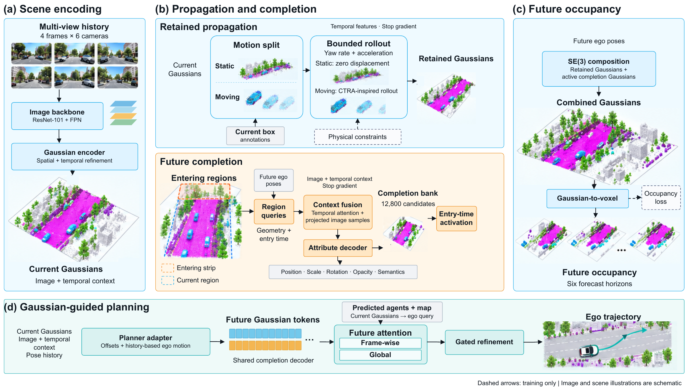

<h1 align="center">GaussPACE<br>Physics-Constrained Gaussian Propagation and Completion for Future Occupancy Forecasting</h1>

<p align="center">
  <a href="#method">Method</a> ·
  <a href="#nuscenes-results">Results</a> ·
  <a href="docs/installation.md">Installation</a> ·
  <a href="docs/data.md">Data and weights</a> ·
  <a href="config/README.md">Configurations</a>
</p>

**GaussPACE** predicts how a 3D driving scene will be occupied over the next three seconds. As the ego vehicle moves, new regions enter the forecast grid. Moving the Gaussians already in the scene can track a passing car, but leaves few primitives to describe a newly visible stretch of road. GaussPACE therefore learns both where existing Gaussians move and where to add new ones.

## Method

[](docs/figures/gausspace-overview.png)

- **Encode the scene (a).** Four frames from each of six cameras provide the current 3D Gaussians and the image features used to forecast the scene.
- **Propagate and complete (b–c).** Current box annotations guide the motion split. Static Gaussians stay in place, while moving Gaussians follow a rollout with bounded acceleration and yaw rate. A second branch uses future ego poses to locate entering regions and camera history to predict their geometry and semantics. At each half-second step, the model combines the propagated and newly active Gaussians in the future ego frame and renders a 120 × 120 × 8 grid with 0.5 m voxels.
- **Plan from predicted Gaussians (d).** The planning adapter estimates ego motion from history. The planner attends to predicted Gaussian features at individual steps and across the horizon, then refines each waypoint with a learned gate. The scene illustrations above are schematic.

## nuScenes results

The manuscript reports these occupancy scores on the **nuScenes validation split** with SurroundOcc labels, using current-frame box annotations and future ego poses. Averaged over the 1, 2 and 3 s forecasts, GaussPACE reaches **20.36% semantic mIoU** and **32.98% occupied IoU**.

| Metric (%) | Current | 1 s | 2 s | 3 s | Mean at 1, 2 and 3 s |
| --- | ---: | ---: | ---: | ---: | ---: |
| Semantic mIoU | 27.20 | 23.42 | 20.27 | 17.38 | **20.36** |
| Occupied IoU | 39.94 | 36.56 | 33.07 | 29.31 | **32.98** |

To compare an evaluation run with the last column, average the three endpoint rows in its log. The evaluator's `Future avg 0.5~3.0s` line includes all six half-second steps.

## Start here

```bash
git clone https://github.com/Rtwotwo/DriveGaussianPACE.git
cd DriveGaussianPACE
```

1. [Install the Python environment and build the CUDA operators](docs/installation.md).
2. [Prepare nuScenes, SurroundOcc labels, metadata and backbone weights](docs/data.md). The reference runs use v4 metadata. The included converter produces v6.
3. Choose a workflow below. Training starts from the R101 DCN FCOS3D backbone. Evaluation requires a trained full-model checkpoint. This repository currently distributes the configurations and launchers without GaussPACE checkpoint weights.

## Evaluate an occupancy checkpoint

After setup, run from the repository root. This example evaluates epoch 20 from the default occupancy training directory on one GPU.

```bash
OCC=config/nuscenes_gs25600_v3_se3_full
GPUS=0 EPOCH=20 bash "$OCC/test.sh"
```

For a checkpoint stored elsewhere, set `CKPT` to its path. The evaluator loads the model strictly and writes current and per-horizon IoU to `exp/nuscenes_gs25600_v3_se3_full/test_epoch_20_occ_console.log` with the settings above.

## Training and planning

| Experiment | What it trains | Initialization |
| --- | --- | --- |
| [Occupancy forecasting](config/nuscenes_gs25600_v3_se3_full/) | Current and future occupancy with detection and map supervision | R101 backbone |
| [Joint occupancy and planning](config/nuscenes_gs25600_v3_se3_ft_plan_futattn_global_residual_full/) | Scene forecasting and a planner that attends to future Gaussians | R101 backbone |
| [Frozen frontend with a VAD planner](config/nuscenes_gs25600_v3_se3_epoch20_ft_plan_vad_full/) | A planning backend on top of a frozen perception model | Compatible trained frontend extracted from a checkpoint |

Train the occupancy model on one eight-GPU node. The reference schedule uses AdamW with a learning rate of `2e-4`, one sample per GPU and 20 epochs. Validation runs every four epochs.

```bash
bash config/nuscenes_gs25600_v3_se3_full/train.sh
```

The trainer looks for `latest.pth` in the work directory on startup. Set `WORK_DIR` to a fresh directory to start an independent run.

To train and evaluate the joint planning model, use its matching pair of launchers.

```bash
PLAN=config/nuscenes_gs25600_v3_se3_ft_plan_futattn_global_residual_full
bash "$PLAN/train_joint_full.sh"
GPUS=0 EPOCH=20 bash "$PLAN/test_joint_full.sh"
```

## Repository layout

| Path | Contents |
| --- | --- |
| [config/](config/) | Experiment definitions, launchers and evaluators |
| [model/](model/) | Gaussian encoders, occupancy heads, planners and CUDA operators |
| [dataset/](dataset/) and [loss/](loss/) | nuScenes loaders, transforms, planning metrics and training objectives |
| [tools/data/](tools/data/) and [tools/viz/](tools/viz/) | Metadata preparation and prediction visualization |
| [train.py](train.py) | Training, validation and checkpoint handling |

## Acknowledgements and license

GaussPACE builds on [GaussianAD](https://github.com/wzzheng/GaussianAD) and the OpenMMLab ecosystem. The occupancy experiments use [nuScenes](https://www.nuscenes.org/nuscenes) and [SurroundOcc](https://github.com/weiyithu/SurroundOcc).

The repository includes an [Apache 2.0 license](LICENSE). The [local aggregation extension](model/head/localagg/setup.py) carries a separate Inria/GRAPHDECO non-commercial research and evaluation notice. Its header references a `LICENSE.md` that is missing from this tree, so redistribution terms for that extension remain unconfirmed.
